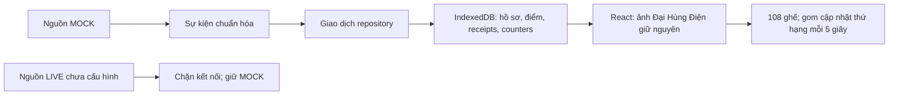

# Chùa Online — chuẩn bị LIVE, hiện chỉ MOCK

## Kiến trúc đã triển khai

`EventAdapter`/`EventSink` và kiểm tra envelope được tái sử dụng từ `src/events`.
Không gọi processor học viện hoặc gửi sự kiện chùa vào backend XP học viện.

- `live/events.ts`: join/comment/like/gift/leave, thêm hương/hoa chỉ cho MOCK;
  version, source, room/session/event ID, thời điểm và viewer `{id,nickname,avatar}`.
- `live/processor.ts`: kiểm tra nguồn/phòng/phiên, identity, duplicate, thời điểm,
  likes cộng dồn và gift streak; tái sử dụng reducer/điểm/tổng tương tác hiện có.
- `live/repository.ts`: giao diện `transact`; IndexedDB và memory implementation.
- `live/sources.ts`: MOCK phát sự kiện cục bộ; LIVE chưa cấu hình chỉ trả trạng
  thái dừng/lý do. Không fetch, WebSocket, connector SDK hoặc thông tin tài khoản.
- `live/seating.ts`: giữ ghế hiện có, lấp chỗ trống ngay; gom đổi thứ hạng tối đa
  mỗi 5 giây. Điểm/tổng tương tác cập nhật ngay sau commit. Chuyển vị trí có
  transition, tôn trọng reduced motion. Không đổi seat map hoặc PNG.
- `live/useTempleSession.ts`: nối adapter/repository/view và trạng thái diagnostics.

☰ có lựa chọn MOCK/LIVE và mô phỏng rời phòng. Chọn LIVE vẫn giữ MOCK và giải thích
chưa có kết nối được duyệt; không hiển thị người giả là dữ liệu LIVE. ID được chọn,
kết quả xử lý, lưu cục bộ/bộ nhớ tạm và nhịp cập nhật ghế đều có thông báo tiếng Việt.
MOCK/LIVE có namespace lưu riêng; LIVE khởi tạo không có người giả hoặc điểm MOCK.

## Identity, đóng góp và presence

ID là chuỗi opaque, tối đa 128 ký tự; không ép Number hoặc lấy nickname/username
làm khóa. ID null không được tạo hồ sơ/cộng điểm. ID malformed, prototype keys,
profile/avatar không hợp lệ bị từ chối. Hai người trùng tên vẫn có hồ sơ riêng.
`templeParticipants()` ghép hồ sơ userId/nickname/avatar với contributionScore.
Avatar lưu như metadata HTTPS hoặc ảnh fallback cục bộ; chưa tải ảnh từ CDN để
không thay chibi hiện có hoặc phát sinh request bên thứ ba.

Giữ điểm hương +5, hoa +8, tim +1, xu quà ×10; comment/join không cộng điểm; vẫn
cap 999999. Các nút, lời nhắn và bảng tương tác cũ giữ nguyên. Giá quà thực tế
sau này phải lấy từ danh mục/provider đáng tin ở server, không tin giá từ browser.

User mới có ID hợp lệ được thêm tự động, không bị giới hạn bởi roster mẫu. Chỗ
trống được lấp mà không dồn các người khác. Đủ 108 chỗ thì top điểm có ghế và
người còn lại chờ. Hòa điểm theo thứ tự tham gia, ghế theo ưu tiên hiện có.
Leave giải phóng ghế nhưng giữ hồ sơ/điểm; rejoin không mất điểm. Timestamp/key
high-water ngăn leave cũ đẩy người vừa quay lại ra ngoài. Không tự suy ra người
im lặng đã rời LIVE; cần sự kiện leave có nguồn đáng tin hoặc quy tắc presence
được chấp thuận riêng.

## Chống trùng, refresh và giới hạn

Khóa receipt: `[source,roomId,sessionId,kind,eventId]`. Đọc snapshot, kiểm receipt,
cập nhật điểm/high-water/presence và ghi snapshot nằm trong cùng transaction
IndexedDB readwrite. UI chỉ nhận kết quả sau commit; nhiều repository/tab được
IndexedDB tuần tự hóa. Mỗi request MOCK dùng UUID mới, giữ sessionId đã lưu.
Refresh khôi phục điểm, counters, receipts, người tham gia và bình luận; không
phát lại notification cũ. Không cần và không đụng DB ảnh/tiến trình học viện.

- Likes delta dựa vào event ID; cumulative viewer likes: snapshot đầu là baseline,
  chỉ chênh lệch dương được tính. Room totals không cộng điểm cá nhân. Mỗi batch
  tối đa 10000; không tự chia để vượt validation. Counter ID phải đúng scope từ
  provider, không tự gán counter phòng thành counter cá nhân.
- Gift intermediate không trả điểm; final hợp lệ trả một lần trên gift/streak ID.
  Final lặp với message ID mới không trả lại; repeat thấp hoặc giá unit thay đổi
  bị chặn. Coins × repeat đạt cap demo thì contribution bão hòa như quy tắc cũ.
- Receipts/high-water tồn tại sau reload/reconnect. Không tự đuổi receipts cũ để
  cho phép cộng lại. Giới hạn 10000 receipts, 1000 hồ sơ; chạm giới hạn fail closed.
  Sự kiện quá cũ 30 giây bị bỏ qua; không phục hồi sự kiện upstream chưa từng nhận.
- Snapshot version 1 được xác thực; bản lưu lỗi/khác phiên bản không bị reset/ghi
  đè. Lỗi lưu trữ chuyển sang bộ nhớ tạm và cảnh báo rõ: điểm mới có thể mất khi
  refresh, bản commit trước vẫn được giữ. Safari có thể xóa dữ liệu website; đây
  chưa phải kho dữ liệu production hay cơ chế chống sửa điểm bằng DevTools.
- Chưa đồng bộ giao diện trực tiếp giữa các tab; refresh/thao tác tiếp theo đọc
  snapshot đã commit. Session/room mới và retention/backup cần quy trình server
  rõ ràng, không tự xóa ledger hoặc chuyển điểm MOCK sang LIVE.

## Nghiên cứu kết nối — kiểm tra tài liệu công khai ngày 07/11/2026

| Phương án | Xác minh / khả năng | Quyền và hạn chế |
| --- | --- | --- |
| TikTok Developers công khai | Danh mục Products và Webhooks Events đã đọc không công bố stream join/comment/like/gift/leave chung. Events đang liệt kê authorization.removed, video.upload.failed, video.publish.completed, portability.download.ready. | Không được suy từ Login Kit/openid hoặc đăng ký callback rằng có quyền đọc LIVE. Cần TikTok xác nhận sản phẩm/scope/điều kiện tài khoản thực sự; có thể tồn tại chương trình đối tác không công khai. |
| Provider/đối tác được phép | Có thể phù hợp với chủ sở hữu chỉ dùng iPad nếu có dịch vụ nhận sự kiện và hợp đồng/quyền hợp lệ. Chưa chọn nhà cung cấp hoặc xác minh quyền của bên nào. | Phải xác minh quyền với TikTok, consent, sự kiện/ID/giá quà, ký request, retention, SLA/quota và chi phí trước khi duyệt. Không mặc định miễn phí. |
| TikTok-Live-Connector (Node) / TikTokLive (Python) | README hiện ghi rõ unofficial, đọc Webcast nội bộ, hỗ trợ chat/gifts/likes/member ở mức thư viện. Có phụ thuộc signature service/Euler Stream và các lựa chọn authenticated session. | README hiện nêu modified AGPL; không import/cài code vào dự án này. Giao thức/ký kết nối/rate limit có thể đổi; không SLA chính thức, cần xem giấy phép/điều khoản/rủi ro tài khoản trước mọi thử nghiệm. |

Nguồn đã đọc trực tiếp:

1. [TikTok Products](https://developers.tiktok.com/products/).
2. [TikTok Webhooks Overview](https://developers.tiktok.com/doc/webhooks-overview/):
   HTTPS callback và at-least-once/retry; điều này không chứng minh có webhook LIVE.
3. [TikTok Webhooks Events](https://developers.tiktok.com/doc/webhooks-events/).
4. [Node connector README](https://github.com/zerodytrash/TikTok-Live-Connector).
5. [Python TikTokLive README](https://github.com/isaackogan/TikTokLive).

Khả năng định danh cần xác minh bằng payload/provider cụ thể:

| Sự kiện | Điều kiện để nhận điểm/hiển thị |
| --- | --- |
| Join/member, comment | Chỉ dùng stable `userId` ở dạng chuỗi; nickname/uniqueId username không đủ. Member events không chứng minh đã nhận đủ toàn bộ người xem. |
| Like | Có payload gộp/room totals hoặc thiếu ID; khi đó không gán điểm cá nhân. Phải xác minh delta/cumulative và scope. |
| Gift | Cần stable viewer ID, message/transaction hoặc streak ID, trạng thái final và giá quà server xác minh. |
| Leave | Chưa xác minh một feed leave đầy đủ/đáng tin. Không hứa phát hiện toàn bộ người rời chỉ từ viewer count hoặc thiếu bình luận. |

SDK/protobuf phải giữ ID 64-bit dưới dạng chuỗi ngay từ đầu; đổi Number sang string
sau khi làm tròn không khôi phục được ID. Provider phải xác định event ID bền qua
reconnect; thiếu ID ổn định không thể hứa exactly-once cho delta/gift tùy ý.

## Phương án đề nghị và điều kiện còn thiếu

Giữ Pages frontend + nguồn MOCK hiện tại. Sau khi chủ sở hữu duyệt nguồn hợp lệ:
nguồn/provider ở server → Worker ingest xác thực → **repository chùa riêng** trong
Durable Object SQLite → snapshot/delta/WebSocket tới frontend. Tái sử dụng thiết kế
auth/sequence/backup có sẵn nhưng không gửi event chùa vào processor XP học viện.
Browser không giữ cookie/token TikTok, không tự tạo sự kiện LIVE có quyền cộng điểm.

Workers Free/DO SQLite là hướng backend hiện có của repo, chưa được triển khai cho
chùa. Connector Node/Python liên tục không phù hợp Pages hoặc Safari chạy nền;
không hứa server/signature service luôn miễn phí. iPad làm màn hình điều khiển;
nhận sự kiện cần hạ tầng luôn hoạt động. Chưa bật dịch vụ trả phí hoặc tạo route.

Trước khi kết nối cần:

- Chủ sở hữu duyệt provider/phương pháp, tài khoản/phòng và phạm vi thử nghiệm;
  có tài liệu quyền TikTok thực sự, không tự đặt tên OAuth scope.
- Thẩm định giấy phép/điều khoản, quota, chi phí; consent/chính sách dữ liệu.
- Fixtures đã ẩn danh chứng minh ID, likes, gifts, leave/reconnect và event keys;
  danh mục giá quà từ server. Định nghĩa session/presence/retention/backup.
- Triển khai server chùa, kiểm auth/CORS/rate limits/durable ledger/snapshot resync;
  duyệt public ingress riêng. Secrets chỉ qua quản lý bí mật server, không chat,
  Git hoặc frontend. Không yêu cầu credentials ở giai đoạn này.

## Kiểm chứng

- `npm test`: **131 pass, 0 fail**; `npm run build`: TypeScript/Vite qua. Lần chạy
  sandbox ban đầu timeout ở Miniflare cũ; chạy ngoài sandbox bằng quyền localhost
  hỗ trợ đã qua toàn bộ. Không sửa/skip test; không đổi network security.
- Browser Chromium: ảnh/108 chỗ/108 tên giữ nguyên; quà/tim/lời chúc còn sau reload;
  leave/rejoin giữ điểm; LIVE chưa cấu hình giữ MOCK, không request ngoài localhost.
- IndexedDB thật: 30 giao dịch song song qua hai repository không mất điểm, lỗi
  trước commit rollback, mở lại rồi replay trả duplicate, MOCK/LIVE cách ly,
  bản ghi corrupt bị từ chối và vẫn còn nguyên. Lỗi storage hiển thị bộ nhớ tạm.
- Unit tests thêm: stable ID lớn, trùng tên, avatar unsafe, source/session mismatch,
  cumulative likes, gift streak, receipt saturation và nhịp đổi ghế.
- [Screenshot iPad](previews/temple-live-foundation-ipad.png). Chưa kiểm Safari
  vật lý; chưa kiểm kết nối TikTok thật hoặc triển khai backend.
